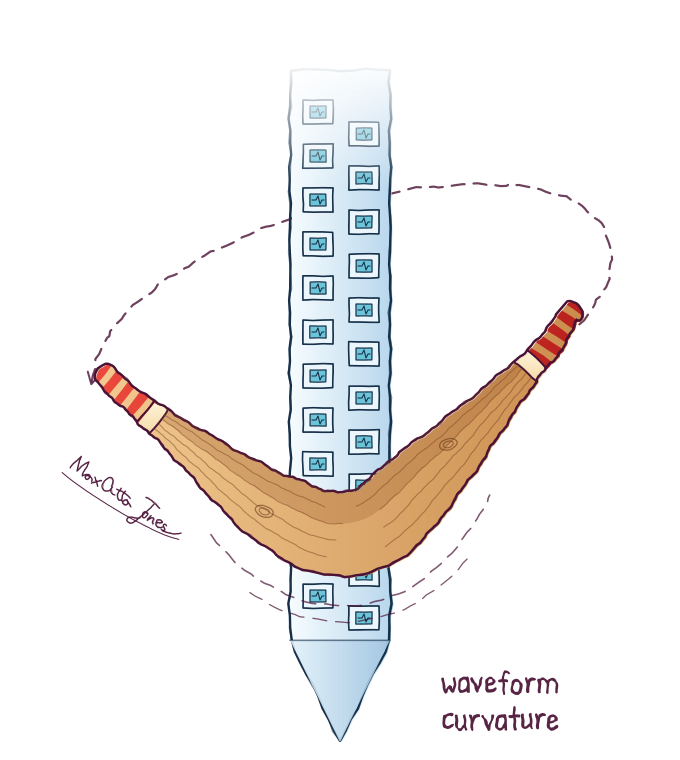
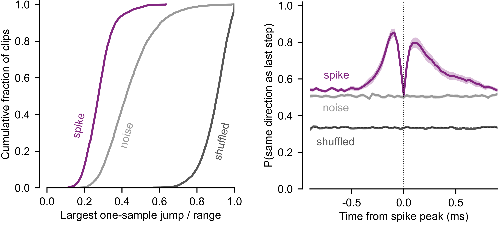

[](https://doi.org/10.5281/zenodo.24504113)
[](./LICENSE)

# 🪃 Waveform Curvature: detecting spikes via their continuous dynamics 🪃


Deciding whether an extracellular event is a spike or an artifact is a fundamental step in spike sorting pipelines. This tool offers a principled alternative to arbitrary amplitude cutoffs by evaluating the physical trajectory of action potentials. Code for Jones & Herzfeld (2026).

Please star the project to support us, using the top-right "⭐ Star" button.

### Purpose

Deciding whether an extracellular event is a spike or an artifact is a fundamental step in spike sorting pipelines. This tool offers a principled alternative to arbitrary amplitude cutoffs by evaluating the physical trajectory of action potentials.

<p align="center">
  
</p>

### Problem & idea

Spike detection forces a tradeoff between missing small/overlapping spikes (high threshold) and flooding the sorter with noise (low threshold). Waveform curvature resolves this by exploiting the continuous and predictable nature of action potentials.

Action potentials exhibit smooth temporal dynamics (fast depolarization and repolarization), visible when embedding the trace along successive time-delays:

$$
\text{curvature} = 1 - \frac{\text{mean}(\text{turn angle})}{\pi}
$$

Straight runs yield curvature near `1`, while chaotic noise yields curvature near `0`.

<p align="center">
  
</p>

### Clear-box approach & noise-derived thresholding

The score is a closed-form geometric calculation requiring no trained models or black boxes. Thresholds are calibrated directly from the recording's own noise by scoring non-triggering background windows and setting a percentile cutoff (e.g., the 95th percentile) to ensure a known false-positive rate.

### Quick start guide

#### Installation

```bash
pip install git+https://github.com/herzfeldlab/WaveformCurvature.git
```

Requires Python 3.9+ and `numpy`.

#### Usage

```python
from waveform_curvature import calibrate_and_filter

keep, scores, threshold = calibrate_and_filter(
    candidate_waveforms,
    noise_waveforms,
    percentile=2.0,   # about 2% of noise passes by chance; lower is stricter
)
```

#### Tuning & API


- **`percentile`**: Controls strictness; lower values drop more noise but risk losing faint spikes. Recompute per session to account for drift.
- `waveform_curvature(waveform, delay=2, dim=None)`: Computes curvature scores.
- `turn_angles(waveform, delay=2, dim=None)`: Returns raw per-point turn angles in radians.
- `calibrate_and_filter(candidate_waveforms, noise_waveforms, ...)`: Scores both pools and returns filtering outputs.

<br clear="right" />

### Experiments & tests

> *UNDER CONSTRUCTION*: Evaluation scripts for SpikeForest recordings can be found in `experiments/README.md`.

<p align="center">
  
</p>

```bash
pip install -e ".[dev]"
pytest
```

### Support and citing

If you find Waveform Curvature useful in your work, we kindly request that you cite: Jones & Herzfeld (2026). https://doi.org/10.5281/zenodo.24504113

### License

MIT. See [`LICENSE`](./LICENSE).
